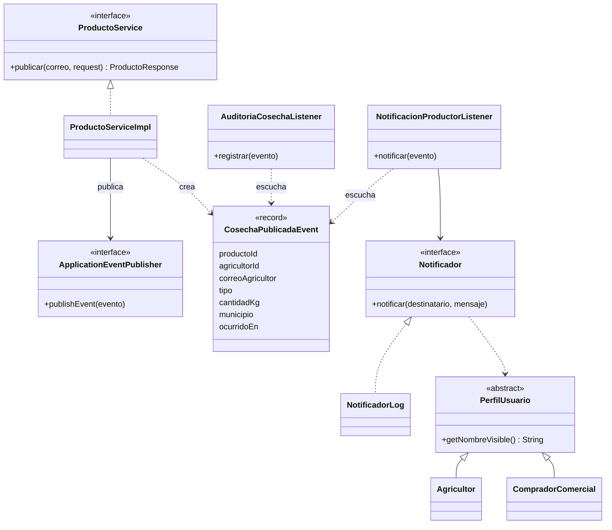

# Patrones de diseño y principios SOLID — AgroValle Connect

Documento del taller de la Sesión 9 (Sprint 2). Describe el patrón comportamental implementado, el problema de
negocio que resuelve, su diagrama de clases y la evidencia de los cinco principios SOLID en el código.

## 1. Patrón comportamental: Observer

### Problema de negocio

Cuando un agricultor publica una cosecha (HU-02) deben ocurrir varias cosas: dejar constancia en la base de datos
para la trazabilidad y avisar al agricultor. Si `ProductoServiceImpl` llamara directamente a cada una de esas
acciones, quedaría acoplado a todas ellas, y agregar una nueva (por ejemplo, actualizar el catálogo de búsqueda de
HU-04 o avisar por WhatsApp) obligaría a modificar y volver a probar el servicio.

### Solución

El servicio publica un único evento, `CosechaPublicadaEvent`, con `ApplicationEventPublisher` de Spring. Cada
interesado es un suscriptor independiente que escucha ese evento. El servicio no conoce a sus suscriptores ni
cuántos existen.

| Rol del patrón | Clase |
|----------------|-------|
| Sujeto (quien publica) | `ProductoServiceImpl`, mediante `ApplicationEventPublisher` |
| Evento | `CosechaPublicadaEvent` (registro inmutable con datos simples, sin entidades) |
| Observador 1 | `AuditoriaCosechaListener` (`@EventListener`): guarda un `RegistroAuditoria` |
| Observador 2 | `NotificacionProductorListener` (`@TransactionalEventListener`): avisa al agricultor |

### Diagrama de clases

### Semántica transaccional

- **Auditoría (`@EventListener`):** se ejecuta dentro de la transacción de la publicación. Si falla, se revierte
  también la cosecha, así que nunca existe una publicación sin rastro.
- **Notificación (`@TransactionalEventListener`, fase `AFTER_COMMIT`):** se ejecuta solo si la transacción se
  confirmó. Si la publicación se revierte, no se avisa al agricultor.

### Cómo agregar un observador nuevo

1. Crear una clase `@Component` con un método anotado con `@EventListener` que reciba `CosechaPublicadaEvent`.
2. No se modifica `ProductoServiceImpl` ni ningún observador existente.

### Pruebas que lo validan

| Prueba | Qué verifica |
|--------|--------------|
| `ProductoServiceTest` | El servicio emite exactamente un evento con los datos de la cosecha, y ninguno si la finca no es válida. |
| `AuditoriaCosechaListenerTest` | El suscriptor de auditoría guarda el registro con la acción, el usuario y el detalle correctos. |
| `NotificacionProductorListenerTest` | El suscriptor notifica al agricultor y no hace nada si el agricultor no existe. |
| `ProductoApiTest` | De extremo a extremo: `201`, evento publicado (`@RecordApplicationEvents`) y registro de auditoría persistido. |

## 2. Principios SOLID

| Principio | Cómo se aplica | Dónde verlo |
|-----------|----------------|-------------|
| **S**RP | Cada capa tiene una sola responsabilidad: los controladores solo traducen HTTP, los servicios aplican las reglas, los repositorios acceden a datos. Cada suscriptor hace una sola cosa. | `controller/`, `service/impl/`, `repository/`, `listener/` |
| **O**CP | Se agregan comportamientos nuevos sin modificar código probado: un canal de notificación nuevo es otra implementación de `Notificador`; un observador nuevo es otro `@Component`. | `Notificador`, `listener/` |
| **L**SP | `Agricultor` y `CompradorComercial` sustituyen a `PerfilUsuario` sin romper su contrato. `Notificador` acepta cualquier `PerfilUsuario`. | `model/PerfilUsuario`, `PerfilUsuarioContratoTest` |
| **I**SP | Interfaces pequeñas y específicas: un repositorio por entidad, una interfaz de servicio por caso de uso y un `Notificador` con un solo método. | `repository/`, `service/`, `notificacion/` |
| **D**IP | Los servicios dependen de interfaces (`AgricultorService`, `ApplicationEventPublisher`, `Notificador`) y reciben sus dependencias por constructor. | `service/impl/*ServiceImpl` |

### Contrato de `PerfilUsuario` (LSP)

- `getNombreVisible()` nunca devuelve un texto vacío en un perfil completo.
- Los subtipos no agregan precondiciones a las operaciones heredadas (teléfono, usuario asociado).
- La superclase es una `@MappedSuperclass`: los campos comunes viven en la tabla de cada subtipo, sin tabla adicional
  ni cambios en el esquema existente.
