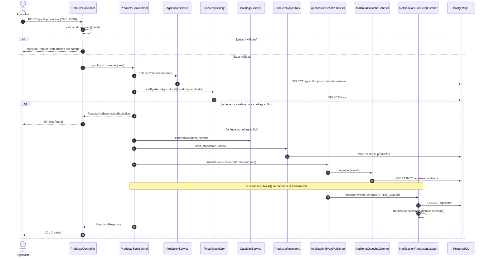
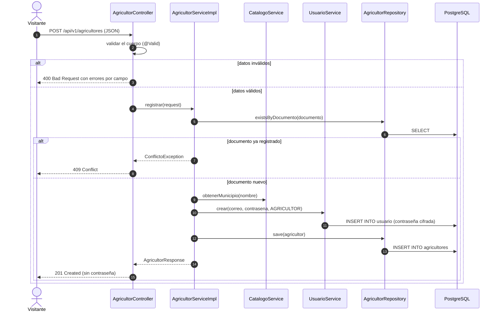
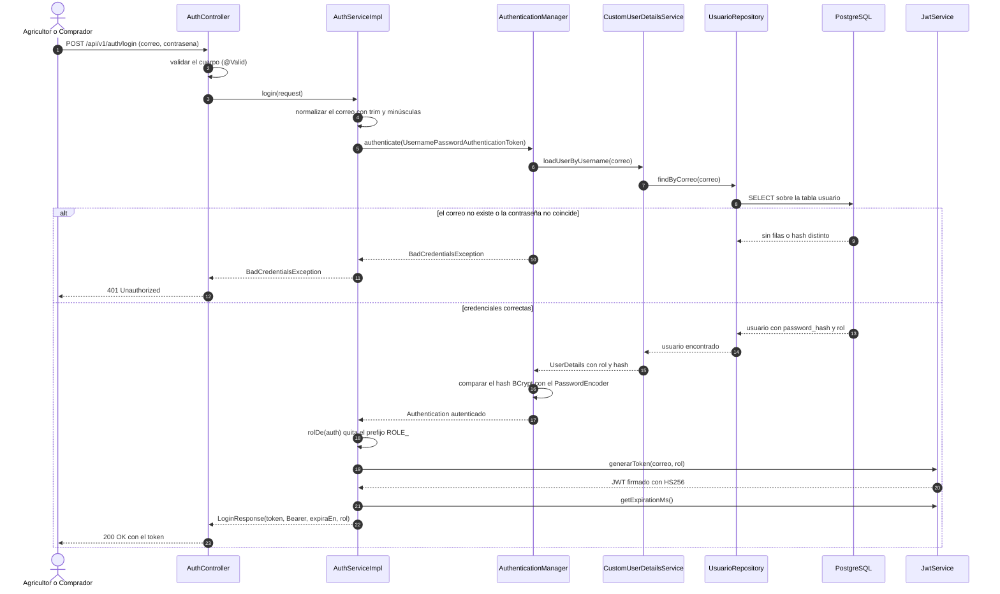
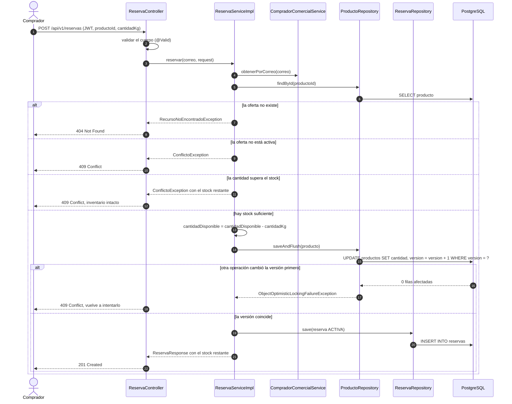
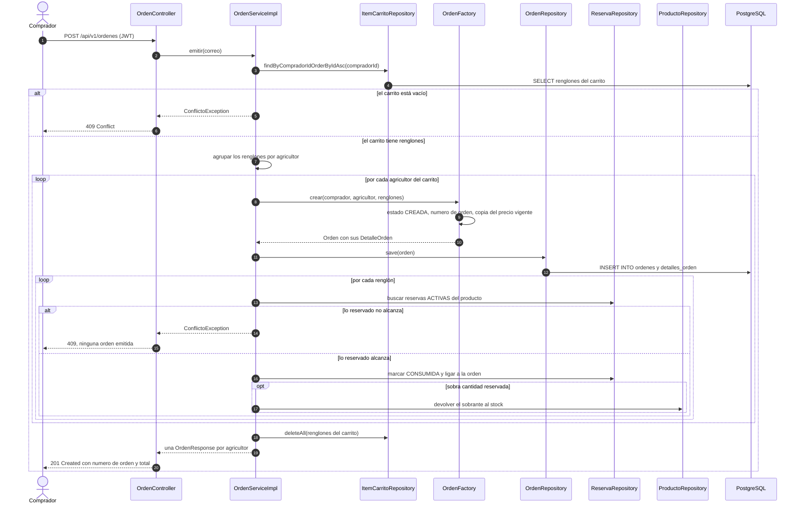
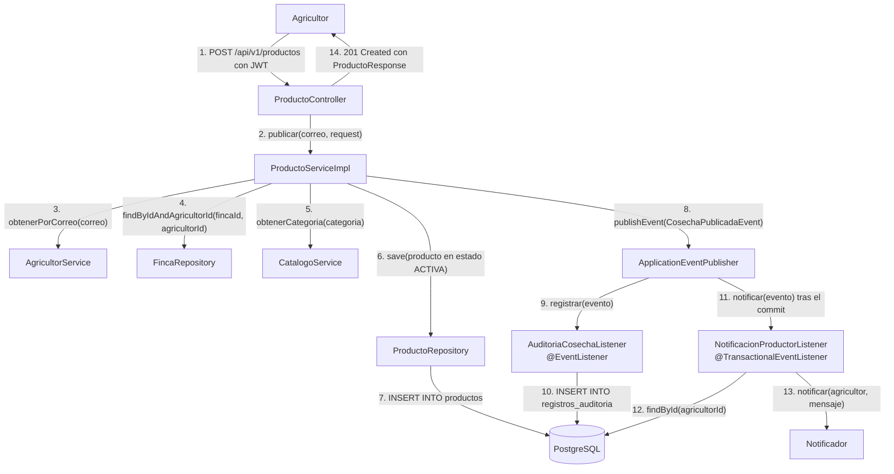
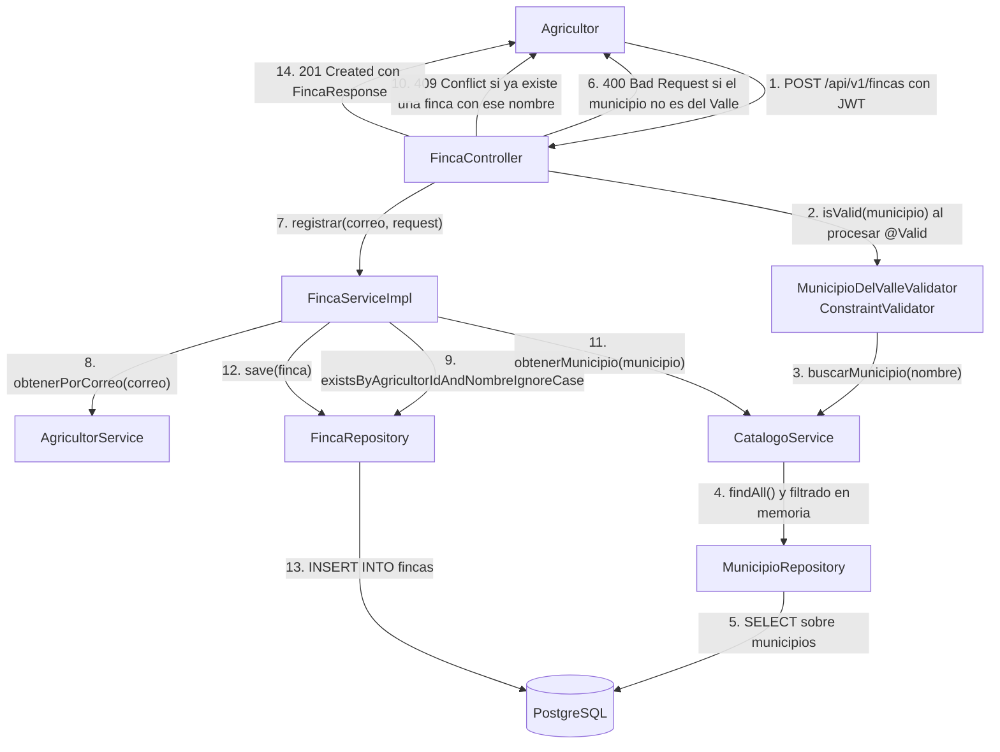
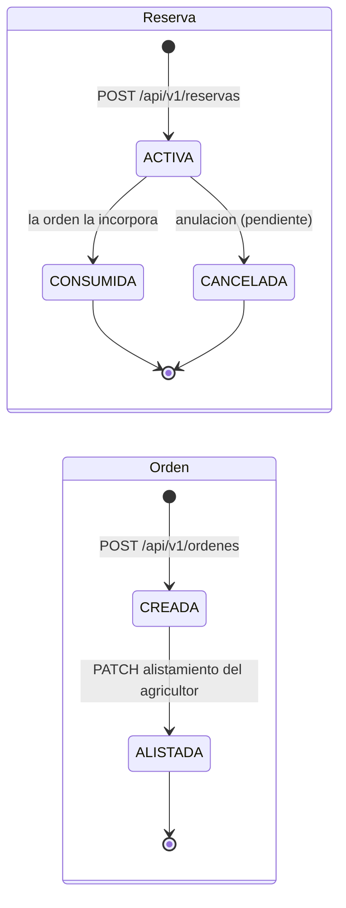
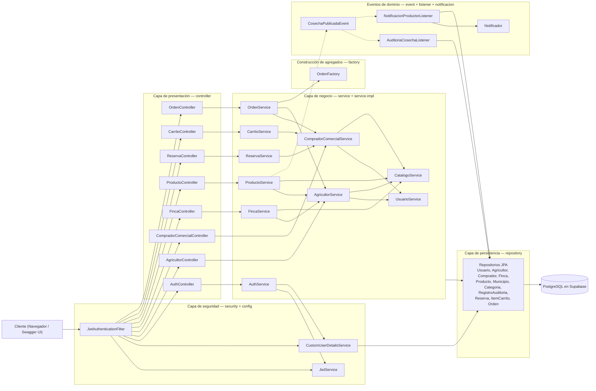
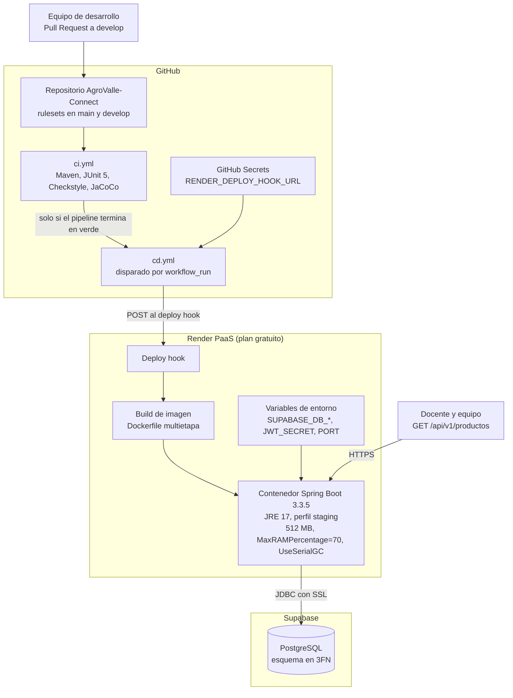

# Documento consolidado de arquitectura — Diagramas UML

AgroValle Connect · Ingeniería de Software II · UNIAJC · período 2-2026

Todos los diagramas están escritos en bloques ` ```mermaid `, de modo que GitHub los
dibuja en la vista previa del archivo sin herramientas externas y quedan versionados
como texto en el repositorio. Reemplazan a los diagramas exportados como imagen desde
Visual Paradigm, que se conservan en `docs/diseno/` como respaldo histórico.

Cada diagrama refleja el código realmente implementado, incluido el flujo de compra completo
—reserva de inventario, carrito, emisión de órdenes y alistamiento—: los nombres de
clases, métodos, endpoints y tablas son los del repositorio, no nombres de diseño
preliminar. Donde el flujo real difiere del esquema de la Sesión 13 se indica en una nota.

**Inventario de diagramas (mínimo exigido: 3 de secuencia, 2 de colaboración, 1 de
componentes, 1 de despliegue):**

| # | Tipo | Alcance | Historia |
| --- | --- | --- | --- |
| 1 | Secuencia | Publicación de una cosecha | HU-02 |
| 2 | Secuencia | Registro de un agricultor | HU-01 |
| 3 | Secuencia | Autenticación e inicio de sesión con JWT | HU-06 |
| 4 | Secuencia | Reserva de inventario con bloqueo optimista | HU-10 |
| 5 | Secuencia | Emisión de órdenes de compra con Factory | HU-12 |
| 6 | Colaboración | Evento desacoplado con Observer al publicar cosecha | HU-02 |
| 7 | Colaboración | Registro de finca con validación de municipio | HU-08 |
| 8 | Estados | Ciclo de vida de la orden y de la reserva | HU-10 a HU-13 |
| 9 | Componentes | Arquitectura multicapa de Spring Boot | — |
| 10 | Despliegue | Topología de staging en la nube | — |

## Trazabilidad de BDD a UML

Los escenarios Given-When-Then del `BACKLOG.md` se traducen en los mensajes de los
diagramas. La correspondencia es directa:

| Historia | Escenario BDD | Endpoint | Diagrama |
| --- | --- | --- | --- |
| HU-01 Registro de agricultores | Dado un visitante con documento no registrado, cuando envía sus datos, entonces queda registrado | `POST /api/v1/agricultores` | 2 |
| HU-02 Publicación de productos | Dado un agricultor autenticado con una finca propia, cuando publica una cosecha, entonces la oferta queda activa | `POST /api/v1/productos` | 1 y 4 |
| HU-06 Autenticación JWT | Dado un usuario registrado, cuando envía credenciales correctas, entonces recibe un token Bearer | `POST /api/v1/auth/login` | 3 |
| HU-08 Registro de finca | Dado un agricultor autenticado, cuando registra una finca en un municipio del Valle, entonces la finca queda asociada a él | `POST /api/v1/fincas` | 7 |
| HU-09 Detalle de oferta | Dado un visitante, cuando consulta una oferta por su identificador, entonces recibe finca, municipio, cantidad y precio | `GET /api/v1/productos/{id}` | 9 |
| HU-10 Reserva de inventario | Dado un comprador autenticado y una oferta activa, cuando reserva una cantidad disponible, entonces el stock se descuenta y la reserva queda activa | `POST /api/v1/reservas` | 4 y 8 |
| HU-11 Carrito | Dado un comprador con ofertas de varios agricultores, cuando consulta su carrito, entonces recibe el subtotal por agricultor y el total | `GET /api/v1/carrito` | 9 |
| HU-12 Emisión de orden | Dado un carrito con stock reservado, cuando emite la orden, entonces se genera una por agricultor en estado CREADA y el carrito queda vacío | `POST /api/v1/ordenes` | 5 y 8 |
| HU-13 Alistamiento | Dado un agricultor con una orden propia en estado CREADA, cuando confirma el alistamiento, entonces la orden pasa a ALISTADA con su marca de tiempo | `PATCH /api/v1/ordenes/{numero}/alistamiento` | 8 |

La numeración de las historias es la del `BACKLOG.md` del equipo. La autenticación es
HU-06 en el backlog del proyecto.

## 1. Diagrama de secuencia: HU-02, publicación de una cosecha



El método `publicar` está anotado con `@Transactional`, de modo que la confirmación
ocurre al salir del servicio. Por eso el oyente de notificación, suscrito con
`@TransactionalEventListener(phase = AFTER_COMMIT)`, se ejecuta antes de que el
controlador devuelva el 201, mientras el de auditoría, con `@EventListener`, corre dentro
de la misma transacción.

## 2. Diagrama de secuencia: HU-01, registro de un agricultor



## 3. Diagrama de secuencia: HU-06, autenticación e inicio de sesión con JWT



La verificación de la contraseña no la hace el servicio: la delega en el
`AuthenticationManager` de Spring Security, que a su vez consulta
`CustomUserDetailsService` y compara el hash con el `PasswordEncoder` configurado. El
servicio solo normaliza el correo, extrae el rol y arma el token. Esta delegación es la
razón de que `AuthServiceImpl` no dependa de `UsuarioRepository`.

Las peticiones posteriores a `GET /api/v1/auth/me` no repiten este flujo: las resuelve
`JwtAuthenticationFilter`, que valida el token en cada petición antes de llegar al
controlador.

## 4. Diagrama de secuencia: HU-10, reserva de inventario



La columna `version` de `productos` es lo que impide vender dos veces el mismo lote. El
`UPDATE` solo afecta filas cuya versión siga siendo la que se leyó: si dos compradores
reservan a la vez, el segundo encuentra cero filas afectadas y recibe 409 en lugar de
llevarse un inventario que ya no existe. El `saveAndFlush` fuerza esa comprobación dentro
de la transacción y no al cerrarla.

## 5. Diagrama de secuencia: HU-12, emisión de órdenes de compra



Tres propiedades que el diagrama hace visibles. El precio se copia a `detalles_orden` en
el momento de emitir, de modo que una orden ya emitida no cambia de valor si el agricultor
reajusta su oferta después. La orden no descuenta inventario: lo descontó la reserva, y
aquí solo se consume, lo que evita el doble descuento. Y todo ocurre en una sola
transacción, así que el 409 por reserva insuficiente deja el carrito intacto y sin ninguna
orden a medio emitir.

## 6. Diagrama de colaboración: HU-02, evento desacoplado con Observer

Mermaid no ofrece un tipo nativo de diagrama de comunicación UML, de modo que se modela
como grafo de objetos con los mensajes numerados en el orden en que ocurren, que es la
información que aporta un diagrama de colaboración frente a uno de secuencia: qué objeto
conoce a qué otro.



El valor del patrón está en lo que el diagrama no muestra: no existe ninguna flecha de
`ProductoServiceImpl` hacia los dos oyentes. El servicio publica un
`CosechaPublicadaEvent` y desconoce quién lo consume, de modo que agregar un tercer
suscriptor no obliga a modificar el servicio. El evento es un `record` que transporta
datos simples, no entidades JPA, para que los oyentes no dependan de la sesión de
persistencia.

## 7. Diagrama de colaboración: HU-08, registro de finca por municipio



La validación del municipio ocurre antes del servicio, no dentro: `MunicipioDelValle` es
una anotación de Bean Validation cuyo validador se dispara cuando el controlador procesa
`@Valid`, y consulta el catálogo a través de `CatalogoService`. El servicio asume que el
municipio ya es válido y se ocupa de la regla de negocio propia: que el agricultor no
tenga dos fincas con el mismo nombre.

Los mensajes 6 y 10 son rutas alternativas de error, no pasos del camino feliz: las
excepciones suben del servicio al controlador y las traduce `GlobalExceptionHandler`, que
es quien construye la respuesta HTTP. `CatalogoService.buscarMunicipio` resuelve el
nombre con `findAll()` y un filtro en memoria sobre el catálogo de municipios, que es una
tabla pequeña y estable.

## 8. Diagrama de estados: ciclo de vida de la orden y de la reserva



Las dos transiciones hacia `CONSUMIDA` y hacia `ALISTADA` son las únicas que el código
ejecuta hoy. `CANCELADA` existe en el modelo porque anular una reserva devuelve stock y
esa operación todavía no tiene historia asignada: se deja declarada para que el día que
llegue no haya que migrar datos. El paso de `CREADA` a `ALISTADA` solo lo puede disparar
el agricultor dueño de la orden, y es irreversible: un segundo intento responde 409 para
no pisar la marca de tiempo original.

## 9. Diagrama de componentes: arquitectura multicapa de Spring Boot



Las cuatro capas quedan separadas por paquete: los controladores solo hablan con
interfaces de servicio, los servicios solo con repositorios, y ninguna capa salta sobre
la siguiente. Las flechas punteadas son comunicación por evento, no invocación directa.
El esquema relacional está en `docs/diseno/schema.sql` y se aplica desde el editor SQL de
Supabase; la migración versionada con Flyway está diferida al Sprint 4.

## 10. Diagrama de despliegue: topología de staging



El Auto-Deploy nativo de Render está desactivado: la única ruta hacia staging es `cd.yml`,
que se dispara por `workflow_run` cuando la integración continua termina correctamente.
No existe forma de publicar un commit que no haya pasado por el pipeline. El servicio se
suspende a los 15 minutos sin tráfico, de modo que la primera petición después de una
pausa levanta el contenedor y tarda más de lo normal.

## Decisiones de arquitectura relacionadas

- [`docs/architecture-decisions/ADR-002-hosting-staging.md`](../architecture-decisions/ADR-002-hosting-staging.md)
  — plataforma de hosting de staging, empaquetado en contenedor, estrategia de despliegue
  y verificación posterior. Es la decisión que sustenta el diagrama 7.
- [`docs/adr/ADR-001-estrategia-de-ramificacion.md`](../adr/ADR-001-estrategia-de-ramificacion.md)
  — adopción de GitFlow, que explica por qué el disparador del pipeline distingue entre
  `develop` y `main`.

El ADR de hosting lleva el número 002 porque el 001 ya estaba asignado a la estrategia de
ramificación desde el Sprint 0. El propio ADR documenta el desfase frente al ejemplo de la
Sesión 12.
