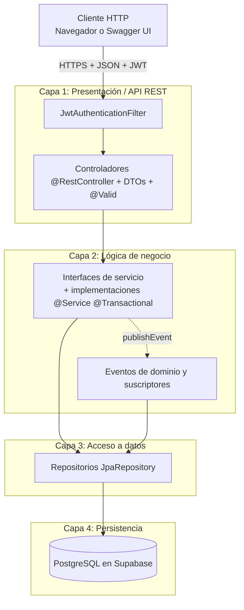

# Arquitectura MVC en 4 capas y patrones GoF — AgroValle Connect

Documento de diseño del Sprint de Diseño (Segundo Corte). Describe la separación en capas, la responsabilidad de
cada una, los patrones de diseño aplicados y cómo viaja una petición por el sistema.

## 1. Vista general

## 2. Las cuatro capas

| Capa | Componentes | Paquete | Responsabilidad en AgroValle |
|------|-------------|---------|------------------------------|
| 1. Presentación / API REST | `@RestController`, DTOs (`record`), `@Valid`, filtro JWT | `controller`, `dto`, `security`, `validation` | Mapea las rutas `/api/v1/...`, valida la forma de los datos y responde con `201`, `200`, `400`, `401`, `403`, `404` o `409`. No contiene reglas de negocio ni SQL. |
| 2. Lógica de negocio | Interfaces de servicio, implementaciones `@Service`, `@Transactional`, excepciones de dominio, eventos | `service`, `service/impl`, `event`, `listener`, `notificacion`, `exception` | Aplica las reglas del negocio agrícola (documento o NIT únicos, finca del propio agricultor, fecha de cosecha vigente) y define las transacciones. |
| 3. Acceso a datos | Interfaces `JpaRepository` | `repository` | Abstrae el acceso a PostgreSQL con operaciones CRUD y consultas derivadas, como `findByEstadoAndFincaMunicipioAndCategoriaOrderByFechaPublicacionDesc`. |
| 4. Persistencia relacional | PostgreSQL 15/16 vía JDBC y entidades JPA | `model` + `docs/diseno/schema.sql` | Almacenamiento permanente con integridad referencial, restricciones de unicidad y `CHECK`. |

Las dependencias solo van hacia abajo: un controlador usa servicios, un servicio usa repositorios, y ninguna capa
conoce a las que están por encima de ella.

## 3. Recorrido de una petición (publicar una cosecha)

1. `JwtAuthenticationFilter` valida el token y carga el usuario y su rol.
2. `SecurityConfig` exige el rol `AGRICULTOR` para `POST /api/v1/productos`.
3. `ProductoController` valida el cuerpo con `@Valid` (fecha de cosecha vigente, cantidad y precio positivos,
   categoría del catálogo) y delega en `ProductoService`.
4. `ProductoServiceImpl` resuelve al agricultor, comprueba que la finca sea suya, guarda el producto y publica el
   evento `CosechaPublicadaEvent`.
5. Los suscriptores reaccionan por separado: auditoría (misma transacción) y notificación (tras confirmar).
6. El controlador responde `201 Created` con el producto publicado.

La secuencia detallada está en [`diagramas-uml.md`](diagramas-uml.md).

## 4. Patrones de diseño

| Patrón | Tipo | Dónde se aplica | Para qué |
|--------|------|-----------------|----------|
| **Repository** | Enterprise | `repository/*Repository` | Encapsula el acceso a la base de datos detrás de interfaces; los servicios no conocen SQL. |
| **Singleton / IoC** | Creacional | Todos los `@Service`, `@Component` y `@Repository` | El contenedor de Spring crea una sola instancia de cada bean y la inyecta por constructor. |
| **DTO** | Enterprise | `dto/*Request`, `dto/*Response` | Aísla las entidades JPA de los contratos JSON que expone la API. |
| **Factory / Mapper** | Creacional | Métodos estáticos `desde(...)` de las respuestas, `ApiError.of(...)` y `UsuarioService.crear` | Centralizan la construcción de objetos y la conversión entre entidades y DTO. |
| **Observer** | Comportamental | `CosechaPublicadaEvent` y los suscriptores de `listener/` | Desacopla la publicación de una cosecha de la auditoría y la notificación. Ver [`patrones.md`](patrones.md). |

## 5. Modelo de datos y su relación con las capas

Cada entidad de `model/` corresponde a una tabla del DER ([`schema.sql`](schema.sql)):

| Entidad | Tabla | Notas |
|---------|-------|-------|
| `Usuario` | `usuario` | Cuenta de acceso con contraseña cifrada y rol. |
| `PerfilUsuario` (abstracta) | — | Superclase mapeada de `Agricultor` y `CompradorComercial` (LSP); no tiene tabla propia. |
| `Agricultor` | `agricultores` | Pertenece a un `Municipio` y a un `Usuario`. |
| `CompradorComercial` | `compradores_comerciales` | Pertenece a un `Municipio` y a un `Usuario`. |
| `Municipio`, `Categoria` | `municipios`, `categorias` | Catálogos con llave foránea desde el resto de las tablas. |
| `Finca` | `fincas` | Pertenece a un `Agricultor` y a un `Municipio`; nombre único por agricultor. |
| `Producto` | `productos` | Pertenece a una `Finca` y a una `Categoria`; control de concurrencia con `@Version`. |
| `RegistroAuditoria` | `registros_auditoria` | Trazabilidad de acciones. |

## 6. Seguridad

- Autenticación sin estado con JWT firmado; el token lleva el correo del usuario y su rol.
- Contraseñas cifradas con BCrypt; nunca se devuelven en las respuestas.
- Rutas públicas: registro de agricultores y compradores, inicio de sesión, consulta de ofertas y documentación.
- Rutas por rol: `POST /api/v1/fincas` y `POST /api/v1/productos` solo para `AGRICULTOR`.
- Respuestas de error uniformes (`ApiError`) para `400`, `401`, `403`, `404` y `409`.

## 7. Atributos de calidad (ISO/IEC 25010)

| Atributo | Cómo se logra |
|----------|---------------|
| Mantenibilidad | Capas separadas, interfaces de servicio, Checkstyle sin advertencias y cobertura JaCoCo ≥ 60 %. |
| Modificabilidad | Observer y la interfaz `Notificador` permiten agregar comportamiento sin tocar código probado. |
| Fiabilidad | Servicios transaccionales, restricciones de integridad en la base de datos y CI obligatoria en cada Pull Request. |
| Seguridad | JWT, BCrypt, control de acceso por rol y respuestas que no revelan información sobre recursos ajenos. |
