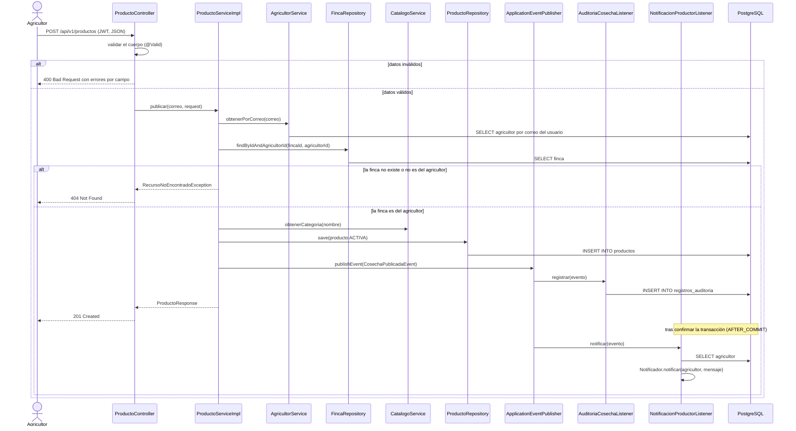
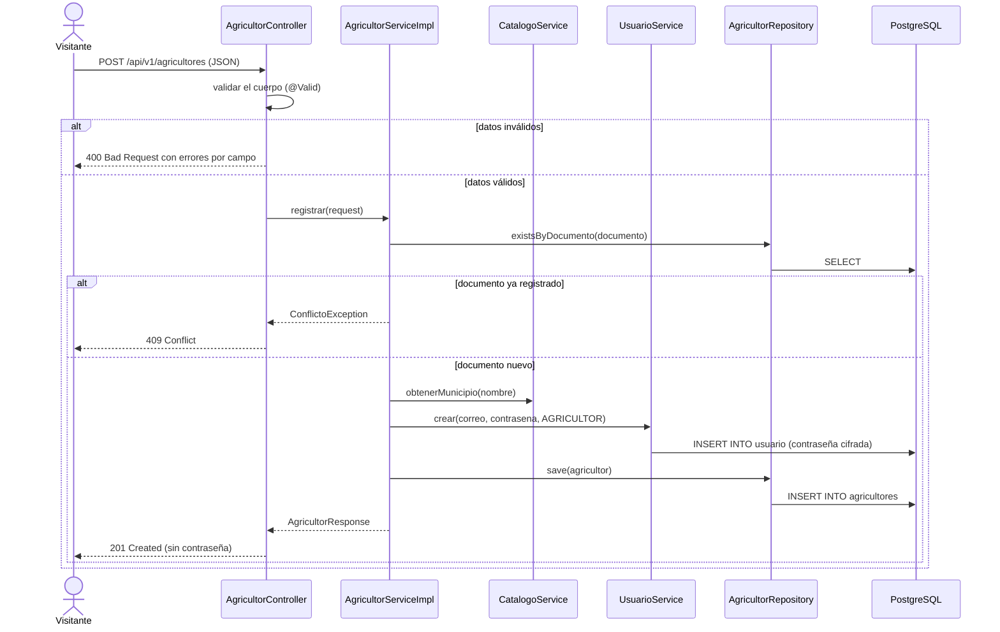
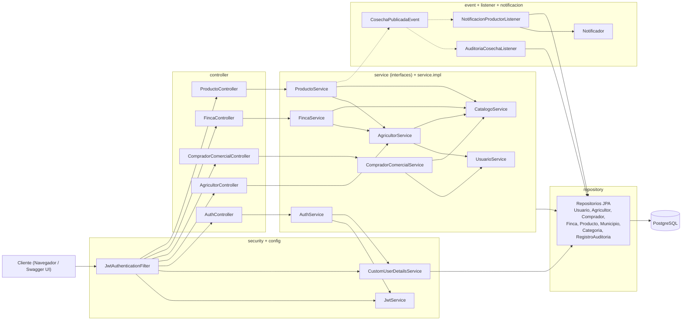

# Diagramas UML — AgroValle Connect

Versiones en Mermaid (GitHub las dibuja directamente) de los diagramas que reflejan el código del Sprint 2.
Complementan los diagramas hechos en Visual Paradigm.

## 1. Diagrama de secuencia: HU-02, publicación de una cosecha

## 2. Diagrama de secuencia: HU-01, registro de un agricultor

## 3. Diagrama de componentes (paquetes Java)

