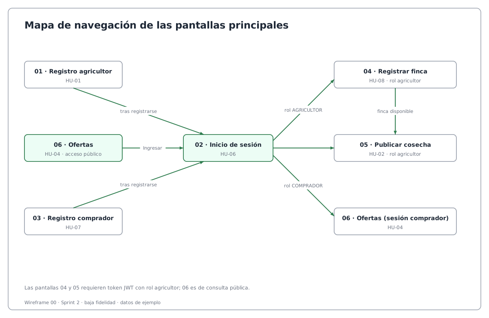
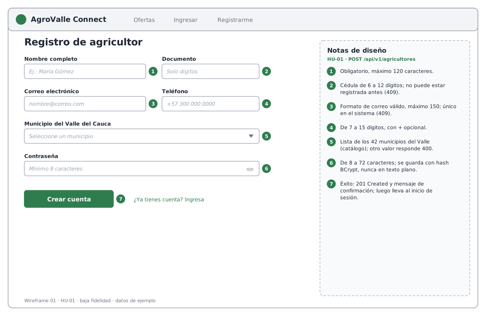
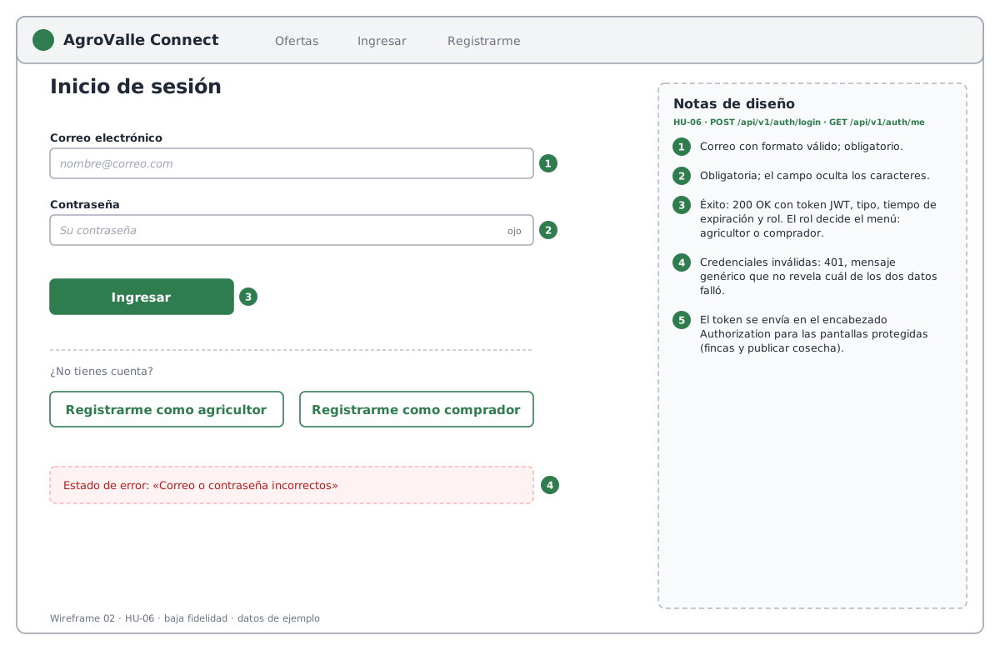
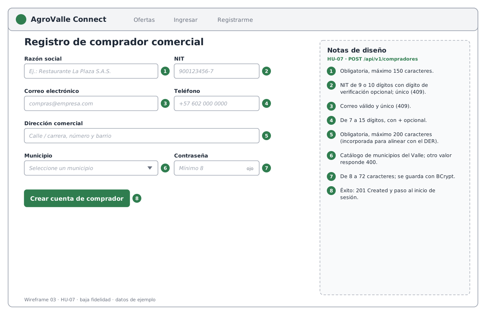
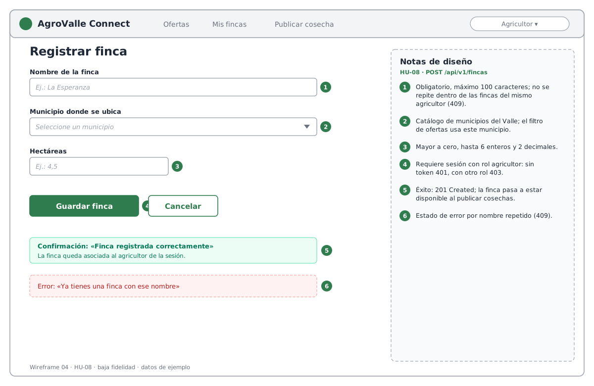
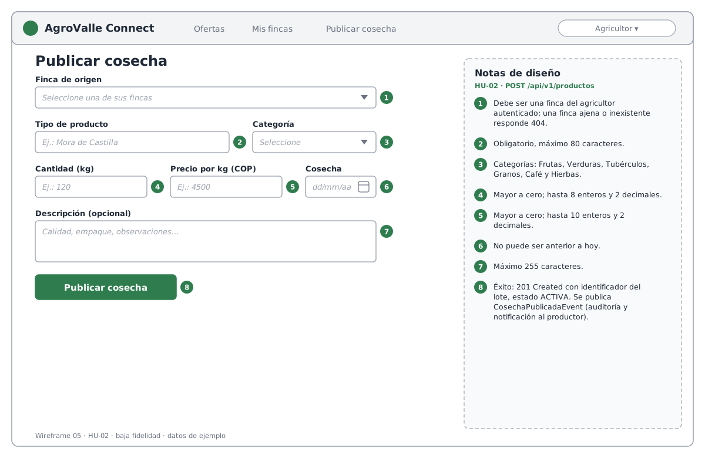
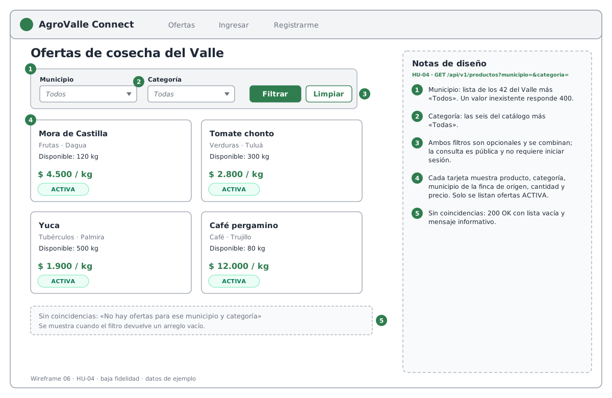

# Wireframes y mockups de las pantallas principales — AgroValle Connect

> Artefacto del Sprint de Diseño (Segundo Corte). Wireframes de baja fidelidad que describen la interfaz de las seis
> pantallas principales construidas sobre la API REST del Sprint 1 y el Sprint 2. Redactado en tercera persona.

## 1. Propósito y alcance

El backend de AgroValle Connect expone una API REST con arquitectura MVC en 4 capas (véase
[`arquitectura-mvc-gof.md`](arquitectura-mvc-gof.md)). Estos wireframes definen cómo un cliente web consumirá esos
endpoints: qué campos se piden, en qué orden, qué estados de éxito y error se muestran y qué reglas de validación se
comunican al usuario. Son de baja fidelidad: no fijan colores definitivos, tipografía ni imágenes, y los datos que
aparecen (productos, municipios, precios) son ejemplos ilustrativos.

Cada wireframe incluye un panel lateral de **notas de diseño** numeradas. Cada número se corresponde con un elemento
del formulario y con una regla del backend (anotaciones de validación de los DTO, restricciones de seguridad o códigos
de respuesta HTTP).

## 2. Mapa de navegación

El visitante puede consultar las ofertas sin iniciar sesión. Para registrar fincas y publicar cosechas necesita
autenticarse con un rol de agricultor; el comprador comercial se registra e ingresa, y consulta las ofertas.

## 3. Pantallas

| N.º | Pantalla | Historia de usuario | Endpoint | Acceso | Archivo |
|-----|----------|---------------------|----------|--------|---------|
| 01 | Registro de agricultor | HU-01 | `POST /api/v1/agricultores` | Público | `wireframe-01-registro-agricultor.png` |
| 02 | Inicio de sesión | HU-06 | `POST /api/v1/auth/login` | Público | `wireframe-02-inicio-sesion.png` |
| 03 | Registro de comprador comercial | HU-07 | `POST /api/v1/compradores` | Público | `wireframe-03-registro-comprador.png` |
| 04 | Registrar finca | HU-08 | `POST /api/v1/fincas` | Rol AGRICULTOR | `wireframe-04-registro-finca.png` |
| 05 | Publicar cosecha | HU-02 | `POST /api/v1/productos` | Rol AGRICULTOR | `wireframe-05-publicar-cosecha.png` |
| 06 | Ofertas con filtros | HU-04 | `GET /api/v1/productos` | Público | `wireframe-06-catalogo-ofertas.png` |

### 3.1 Pantalla 01 — Registro de agricultor (HU-01)

Campos: nombre completo, documento, correo, teléfono, municipio del Valle y contraseña. El documento y el correo
duplicados se informan como conflicto (`409`); un municipio fuera del catálogo se informa como error de validación
(`400`). La contraseña se almacena con hash BCrypt.

### 3.2 Pantalla 02 — Inicio de sesión (HU-06)

El inicio de sesión devuelve un token JWT, su tiempo de expiración y el rol del usuario. El rol determina las opciones
del menú. Las credenciales inválidas responden `401` y la pantalla muestra un mensaje que no revela si falló el correo
o la contraseña.

### 3.3 Pantalla 03 — Registro de comprador comercial (HU-07)

Además de los datos de contacto, solicita razón social, NIT, dirección comercial y municipio, para alinear el registro
con el modelo entidad-relación.

### 3.4 Pantalla 04 — Registrar finca (HU-08)

Solo el agricultor autenticado puede registrar fincas (sin token `401`, con otro rol `403`). La finca queda asociada al
agricultor del token y no puede repetir nombre dentro de sus propias fincas (`409`).

### 3.5 Pantalla 05 — Publicar cosecha (HU-02)

El lote se asocia a una finca del agricultor autenticado; una finca ajena o inexistente responde `404` para no revelar
la existencia de fincas de terceros. Al publicarse, el sistema emite `CosechaPublicadaEvent`, que activa la auditoría y
la notificación al productor mediante el patrón Observer.

### 3.6 Pantalla 06 — Ofertas con filtros (HU-04)

Los filtros de municipio y categoría son opcionales y se combinan. Solo se listan ofertas en estado `ACTIVA`. Cuando
no hay coincidencias se muestra un mensaje informativo en lugar de un error.

## 4. Trazabilidad con la arquitectura

| Capa (MVC en 4 capas) | Relación con los wireframes |
|-----------------------|-----------------------------|
| Presentación (`@RestController`, DTO) | Cada formulario corresponde a un DTO de solicitud (`AgricultorRequest`, `LoginRequest`, `CompradorComercialRequest`, `FincaRequest`, `ProductoRequest`). Las reglas se anotan en el panel de notas. |
| Servicio / Dominio | Las reglas de negocio visibles al usuario (duplicados, propiedad de la finca, estado de la oferta) se resuelven en los servicios. |
| Repositorio | El filtro de ofertas se traduce en una consulta con parámetros opcionales. |
| Persistencia | Municipios y categorías son catálogos en base de datos, de donde se alimentan las listas desplegables. |

## 5. Fuente editable

Los archivos `.svg` de esta carpeta son la fuente editable de cada wireframe y los `.png` son su exportación para
incluirlos en documentos y en el PDF de entrega.
