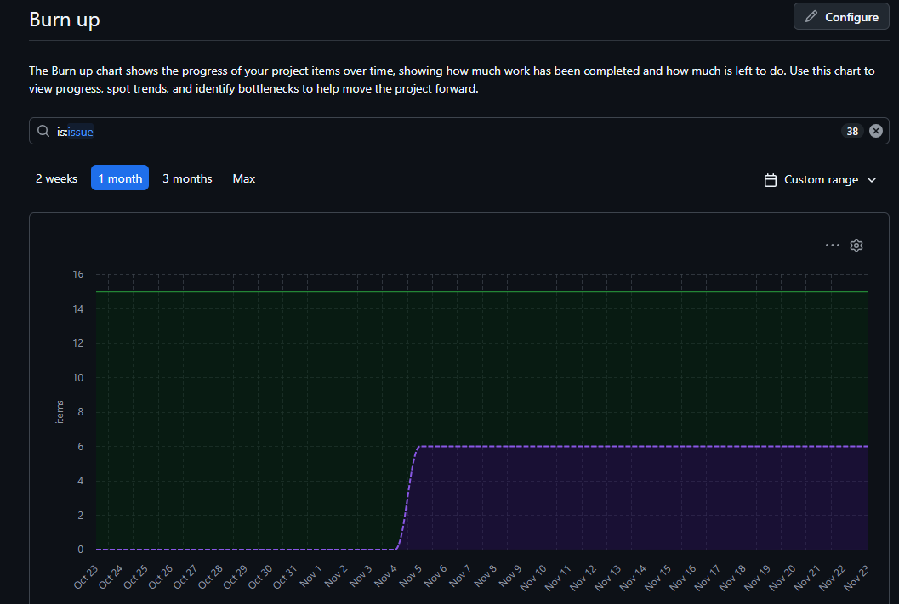
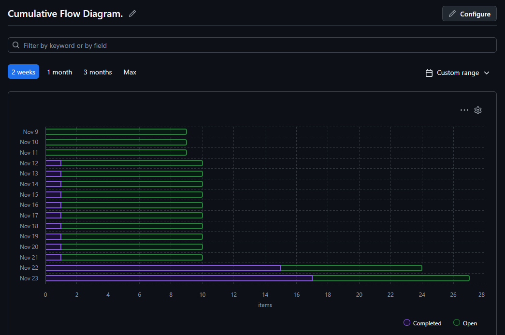
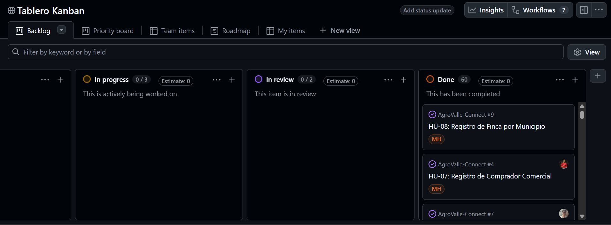
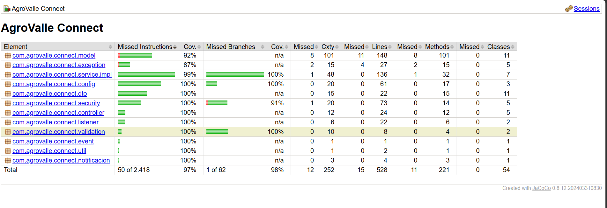

# Informe de métricas ágiles — Corte 3

AgroValle Connect · Ingeniería de Software II · UNIAJC · período 2-2026
Fecha de corte de la medición: 23 de noviembre de 2026.

## 1. Alcance y método

Este informe reúne las métricas de flujo y de calidad del proyecto al cierre del tercer corte:
velocidad por Sprint, trabajo pendiente y flujo acumulado, tiempos de ciclo y entrega, e
indicadores de calidad de ingeniería.

Las cifras no se estimaron: se midieron sobre el repositorio y sobre las herramientas del
proyecto.

| Métrica | Fuente de los datos | Forma de obtención |
| --- | --- | --- |
| Story Points planificados y ejecutados | `sprint-1-planning.md`, `sprint-2-planning.md`, `BACKLOG.md` | Conteo directo sobre los documentos de planificación |
| Burn up y flujo acumulado | GitHub Projects, pestaña *Insights* | Exportación de los gráficos históricos del tablero |
| Cycle Time | Historial de Git de las 29 ramas fusionadas por Pull Request | Diferencia entre el primer commit de cada rama y su commit de fusión |
| Cobertura, pruebas y estilo | `mvn clean verify` sobre `develop` | Reporte de JaCoCo y salida de Checkstyle |

La medición del Cycle Time se automatizó recorriendo los commits de fusión del historial: para
cada Pull Request se tomó el commit más antiguo exclusivo de su rama y se restó del momento de la
fusión. Se excluyeron las fusiones de integración entre `main` y `develop`, que no representan
trabajo técnico sino sincronización de ramas.

## 2. Velocidad del equipo: Story Points planificados frente a ejecutados

| Sprint | Historias comprometidas | SP planificados | SP ejecutados | Cumplimiento |
| --- | --- | --- | --- | --- |
| Sprint 1 | HU-01 (3), HU-06 (5), HU-07 (3) | 11 | 11 | 100 % |
| Sprint 2 | HU-08 (3), HU-02 (5), HU-04 (3) | 11 | 11 | 100 % |
| Sprint 3 | Sin planificación en Story Points | — | — | No aplica |

**Velocidad promedio de los Sprints estimados: 11,0 Story Points por Sprint.**

Los Sprints 1 y 2 se planificaron con la misma capacidad y la cumplieron por completo. La
coincidencia exacta entre lo comprometido y lo entregado en ambos Sprints no significa precisión
en la estimación: significa que el equipo comprometió exactamente su capacidad declarada y no
reservó margen, observación que la retrospectiva del Sprint 1 ya había registrado.

El Sprint 3 no tuvo ceremonia de planificación con estimación en Story Points. Su alcance se
definió a partir de una auditoría del repositorio y se ejecutó como trabajo de infraestructura y
documentación, no como historias de usuario. Medirlo en Story Points supondría asignarle
estimaciones retroactivas, lo que invalidaría la comparación. Su avance se reporta en la unidad en
que realmente se gestionó:

| Sprint 3 | Resultado |
| --- | --- |
| Pull Requests integrados | 13 entre el 21 y el 23 de noviembre |
| Origen del alcance | Plan de corrección de la auditoría interna del repositorio, ejecutado por bloques |
| Entregables de infraestructura | Perfil de staging, `Dockerfile` multietapa, pipeline de CD, CORS y Swagger por entorno |
| Entregables de documentación | ADR-002, documento consolidado de UML, review del Sprint 1, evidencias del Sprint 2 |

## 3. Burndown y Diagrama de Flujo Acumulado

Ambos gráficos se exportaron de la pestaña *Insights* del tablero de GitHub Projects. GitHub genera
el gráfico de trabajo en su variante *Burn up*, que presenta la misma información que un Burndown de
forma acumulativa en lugar de decreciente: en vez de mostrar el trabajo que falta, muestra el
trabajo completado contra el alcance total.

### 3.1 Burn up

El alcance total se mantiene estable en 15 elementos durante todo el periodo observado, del 23 de
octubre al 22 de noviembre: no hubo ampliación de alcance a mitad de camino. La línea de trabajo
completado sube de 0 a 6 entre el 4 y el 5 de noviembre y permanece plana hasta el cierre del corte.

Esos seis elementos son las seis Historias de Usuario de los Sprints 1 y 2: HU-01, HU-06, HU-07,
HU-08, HU-02 y HU-04. La meseta posterior al 5 de noviembre no indica que el proyecto se detuviera,
y conviene leerla junto con la sección 2: el Sprint 3 no cerró Historias de Usuario porque su
alcance fue infraestructura y documentación, trabajo que se gestionó como Pull Requests y no como
elementos del tablero. El gráfico confirma por una vía independiente lo que la tabla de velocidad ya
declaraba.

### 3.2 Diagrama de Flujo Acumulado

El diagrama acumula los elementos por estado entre el 9 y el 23 de noviembre. Del 9 al 21 el volumen
se mantiene estable en torno a diez elementos, con uno completado. El 22 de noviembre el total salta
a 24 elementos con 15 completados, y el 23 a 27 con 17. Ese escalón corresponde a la ejecución del
plan de corrección del Sprint 3: nueve Pull Requests integrados en dos días.

La franja de trabajo abierto no se ensancha en ningún momento del periodo. En términos de flujo
Scrumban eso significa ausencia de cuello de botella: el trabajo que entró al tablero salió, en vez
de acumularse en un estado intermedio. Es coherente con el estado del tablero al cierre del corte.

### 3.3 Límites de trabajo en progreso

El tablero opera con límites de trabajo en progreso declarados y visibles: `In progress` limitado a
3 elementos e `In review` limitado a 2, conforme al límite WIP = 3 que exige el proceso Scrumban.
Al cierre del corte ambas columnas están en cero y la columna `Done` acumula 60 elementos.

## 4. Tiempos de flujo

### 4.1 Cycle Time medido

| Ámbito | Pull Requests | Promedio | Mediana | Mínimo | Máximo |
| --- | --- | --- | --- | --- | --- |
| Proyecto completo | 29 | 27,2 min | 8,4 min | 1,8 min | 4 h 25 min |
| Sprint 1 | 4 | 5,0 min | 4,8 min | 1,8 min | 8,4 min |
| Sprint 2 | 11 | 9,9 min | 9,6 min | 1,8 min | 26,4 min |
| Sprint 3 | 13 | 50,2 min | 11,4 min | 3,6 min | 4 h 25 min |

### 4.2 Interpretación técnica

**Estas cifras no miden eficiencia de desarrollo.** Un Cycle Time promedio de 27 minutos para una
funcionalidad completa es imposible, y presentarlo como logro sería un error de lectura. Lo que
miden es el intervalo entre el momento en que el trabajo entra al repositorio y el momento en que
alcanza la línea principal. Hay dos causas, y conviene separarlas.

La primera es el flujo de trabajo del equipo: la rama se crea cuando el trabajo ya está hecho en la
copia local, se confirma en uno o dos commits y se fusiona enseguida. El desarrollo ocurre antes
del primer commit, de modo que Git no tiene forma de observarlo. Por eso el número es pequeño
incluso midiendo desde el primer commit de la rama y no desde la apertura del Pull Request.

La segunda es la ausencia de una ventana de revisión. En los Sprints 1 y 2, con una mediana por
debajo de los 10 minutos, ningún Pull Request estuvo abierto el tiempo necesario para que otro
integrante lo leyera. El Peer Review existía como norma escrita, no como práctica verificable. Esta
es la causa raíz del hallazgo AV-006 de la auditoría, y el propio número es su mejor evidencia.

El Sprint 3 muestra el primer cambio de tendencia: la mediana sube a 11,4 minutos y el promedio a
50 minutos, con dos Pull Requests que permanecieron abiertos 3 h 17 min y 4 h 25 min. No es
todavía revisión por pares, pero sí trabajo que dejó de fusionarse de forma inmediata. La medida
correctiva ya está aplicada: desde el Sprint 3 el ruleset de `develop` exige una aprobación antes
de fusionar, de modo que el Cycle Time del Sprint 4 incorporará por fuerza el tiempo de revisión.

### 4.3 Lead Time

**El Lead Time no es medible con los datos que el proyecto registra hoy.** Su definición exige la
fecha en que cada Historia de Usuario se crea en el Product Backlog y la fecha en que queda
desplegada en Staging. El `BACKLOG.md` es un documento Markdown versionado: registra las historias,
su priorización MoSCoW y su estimación, pero no la fecha de creación de cada una. Tampoco existe
registro de la fecha en que cada historia pasó a `In Progress` en el tablero.

Reportar un promedio sin ese dato equivaldría a inventarlo. En su lugar se deja constancia de qué
falta para medirlo en el Sprint 4:

1. Las Historias de Usuario ya existen como *issues* del repositorio y aparecen en el tablero de
   GitHub Projects con su número. GitHub conserva la fecha de creación de cada una y la fecha de
   cada cambio de estado.
2. Esa información se exporta desde la pestaña *Insights* del tablero, o desde la vista de tabla
   del proyecto agregando las columnas de fecha.
3. Con el despliegue a staging ya automatizado desde el pipeline, la fecha de llegada a staging
   queda registrada en el historial de ejecuciones de `cd.yml`.

Con esos tres elementos el Lead Time del Sprint 4 será medible sin trabajo adicional.

## 5. Indicadores de calidad de ingeniería

| Indicador | Umbral exigido | Resultado medido |
| --- | --- | --- |
| Cobertura de instrucciones (JaCoCo) | ≥ 60 % | 98,7 % — 32 instrucciones sin cubrir de 2.418 |
| Cobertura de ramas (JaCoCo) | ≥ 60 % | 98,4 % — 1 rama sin cubrir de 62 |
| Pruebas automatizadas | Todas en verde | 135 ejecutadas, 0 fallos, 0 errores |
| Estilo Checkstyle | 0 violaciones | 0 violaciones |
| Verificación automática del despliegue | `GET /api/v1/productos` responde 200 | Comprobada por el paso final de `cd.yml` |

Las cifras provienen de una ejecución limpia de `mvn clean verify` del 23 de noviembre de 2026, con
los umbrales de `jacoco:check` cumplidos. El hallazgo AV-011 quedó cerrado: el paquete `exception`
pasó de 87 % a 100 % de instrucciones al cubrir las ramas de error de `GlobalExceptionHandler`, lo que
redujo las instrucciones sin cubrir de 50 a 32. Las 32 restantes son accesores de identificadores en
las entidades JPA del paquete `model`; cubrirlas elevaría el porcentaje sin ejercitar comportamiento
alguno, de modo que se dejan como están, a 38 puntos por encima del umbral del 60 % que exige el
`Definition of Done`.

## 6. Divergencias respecto de la plantilla de la Sesión 14

La plantilla de la sesión presenta cifras de referencia para AgroValle Connect que no coinciden con
lo que el repositorio registra. Se documentan aquí en lugar de reproducirlas, porque el informe
debe reflejar el proyecto medido.

| Métrica | Cifra de la plantilla | Cifra medida en el proyecto | Causa de la diferencia |
| --- | --- | --- | --- |
| Story Points del Sprint 1 | 10 comprometidos, 10 completados | 11 comprometidos, 11 completados | La capacidad declarada en `sprint-1-planning.md` es de 11 SP: HU-01 (3), HU-06 (5) y HU-07 (3) |
| Story Points del Sprint 2 | 15 comprometidos, 15 completados | 11 comprometidos, 11 completados | La capacidad del Sprint 2 se mantuvo en 11 SP: HU-08 (3), HU-02 (5) y HU-04 (3) |
| Story Points del Sprint 3 | 20 comprometidos, 20 completados | Sin estimación | El Sprint 3 se definió a partir de una auditoría y no se planificó en Story Points |
| Velocidad promedio | 15,0 SP por Sprint | 11,0 SP por Sprint | Promedio de los dos Sprints que sí se estimaron |
| Cycle Time promedio | 1,8 días por tarea técnica | 30,0 minutos por Pull Request | El trabajo se desarrolla fuera de la rama y los Pull Requests se fusionan sin ventana de revisión, según el análisis de la sección 4.2 |
| Lead Time promedio | 4,5 días por Historia de Usuario | No medible | El `BACKLOG.md` no registra la fecha de creación de cada Historia de Usuario |

## 7. Acciones derivadas para el Sprint 4

| Acción | Métrica que habilita | Estado |
| --- | --- | --- |
| Exigir una aprobación antes de fusionar a `develop` | Cycle Time con ventana de revisión real | Aplicada en el Sprint 3 |
| Registrar la fecha de creación y de cambio de estado de cada Historia de Usuario en el tablero | Lead Time | Pendiente |
| Planificar el Sprint 4 con estimación en Story Points | Velocidad comparable entre Sprints | Pendiente |
| Crear la rama antes de empezar el trabajo, no al terminarlo | Cycle Time que refleje el desarrollo real | Pendiente |
| Cubrir las ramas de error de `GlobalExceptionHandler` | Cobertura de ramas | Aplicada en el Sprint 3, hallazgo AV-011 cerrado |

## Anexo · Cycle Time por Pull Request

| PR | Rama | Commits | Cycle Time |
| --- | --- | --- | --- |
| #17 | `feature/sprint1-readme` | 1 | 3.6 min |
| #18 | `feature/sprint1-readme` | 1 | 8.4 min |
| #19 | `feature/sprint1-docs` | 1 | 1.8 min |
| #20 | `feature/sprint1-docs` | 2 | 6.0 min |
| #44 | `feature/pipeline-github-actions-ci` | 1 | 1.8 min |
| #45 | `feature/unificar-proyecto` | 5 | 26.4 min |
| #46 | `feature/sprint2-planning` | 1 | 6.6 min |
| #47 | `feature/HU-08-registro-finca` | 3 | 10.8 min |
| #48 | `feature/sprint2-diseno` | 1 | 6.6 min |
| #49 | `feature/refactor-solid-servicios` | 2 | 6.6 min |
| #50 | `feature/HU-02-publicacion-productos` | 2 | 9.6 min |
| #51 | `feature/reestructurar-proyecto` | 2 | 14.4 min |
| #52 | `feature/modelo-der-hu04-docs` | 2 | 3.0 min |
| #53 | `feature/test-fallo-ci` | 2 | 12.0 min |
| #54 | `feature/sprint2-cierre-docs` | 3 | 11.4 min |
| #55 | `JuanDavidVM-patch-1` | 1 | 6.6 min |
| #58 | `fix/perfil-staging` | 2 | 1 h 41 min |
| #59 | `chore/higiene-repositorio` | 1 | 3.6 min |
| #60 | `feat/dockerfile-staging` | 2 | 4 h 25 min |
| #62 | `feat/cd-pipeline` | 2 | 11.4 min |
| #64 | `fix/seguridad-staging` | 2 | 16.2 min |
| #67 | `docs/adr-hosting` | 1 | 9.6 min |
| #69 | `docs/uml-completo` | 1 | 5.4 min |
| #70 | `docs/sprint-1-review` | 1 | 4.8 min |
| #71 | `docs/evidencias-sprint-2` | 5 | 3 h 17 min |
| #74 | `docs/metricas-corte3` | 1 | 4.2 min |
| #76 | `fix/evidencia-rulesets` | 1 | 4.8 min |
| #78 | `test/cobertura-y-alineacion-hu01` | 1 | 13.2 min |
| #80 | `fix/url-staging-nueva-region` | 1 | 15.6 min |

Las fusiones de integración entre `main` y `develop` no aparecen en la tabla: sincronizan ramas y no
corresponden a trabajo técnico.
