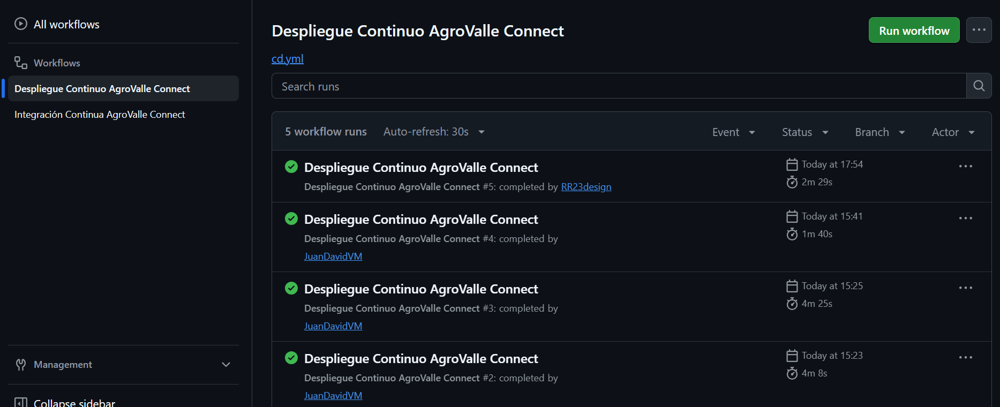
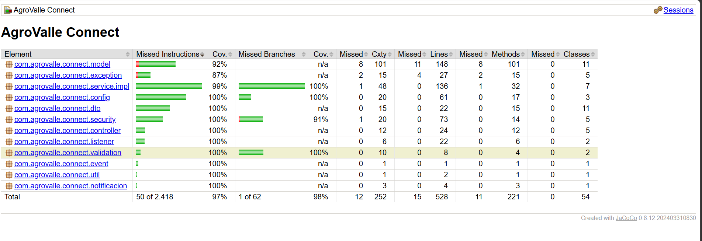
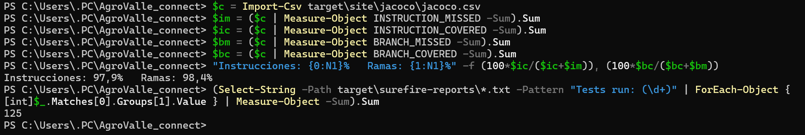
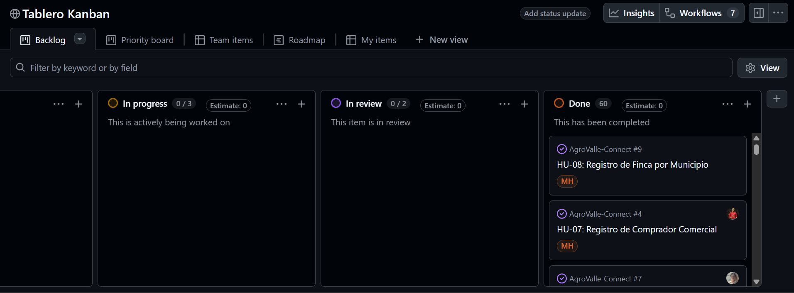
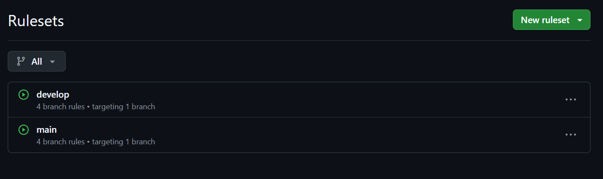

# Sprint 2 Review — AgroValle Connect

> Documento de evidencias de la demostración técnica del Sprint 2, redactado en tercera persona.
> Proyecto integrador de Ingeniería de Software II — UNIAJC, período 2026-2.

## 1. Información de la sesión

| Campo | Detalle |
|-------|---------|
| Proyecto | AgroValle Connect (Java 17, Spring Boot, PostgreSQL) |
| Sprint | 2 — Segundo Corte (30 %) |
| Periodo del Sprint | 29 de octubre – 3 de noviembre de 2026 (entrega en plataforma: 4 de noviembre, 23:59) |
| Fecha y hora de la Review | 5 de Octubre de 2026 7:00 Am |
| Product Owner | Juan David Vidal Muñoz |
| Scrum Master | Robert Andres Preciado |
| QA | Juan Esteban Quintero Berrio, Juan David Gonzales Mendez |
| Asistentes a la sesión | Juan David Vidal Muñoz, Juan Esteban Quintero, Robert Andres Preciado, Juan David Gonzales Mendez |

## 2. Objetivo del Sprint y resultado

**Objetivo.** Un agricultor autenticado puede registrar sus fincas por municipio del Valle y publicar lotes de cosecha
asociados a una finca, y un comprador puede filtrar las ofertas por municipio y categoría. La publicación de una
cosecha notifica a otros componentes mediante el patrón Observer, sin acoplar el servicio emisor a los receptores.

**Resultado.** El Scrum Team integró las tres historias comprometidas mediante Pull Requests fusionados. La
publicación de cosechas emite `CosechaPublicadaEvent`, y los suscriptores de auditoría y de notificación actúan de
forma independiente del servicio emisor.

## 3. Historias de usuario del Sprint

| ID | Historia | SP | Integración (Pull Request) | Estado |
|----|----------|----|----------------------------|--------|
| HU-08 | Registro de Finca por Municipio | 3 | #47, fusionado el 30 de octubre | Terminada |
| HU-02 | Publicación de Productos | 5 | #50, fusionado el 2 de noviembre | Terminada |
| HU-04 | Filtro de Categorías y Municipios | 3 | #52, fusionado el 4 de noviembre | Terminada |
| | **Total** | **11** | | **11 de 11 SP integrados** |

Trabajo técnico asociado, también integrado mediante Pull Request:

| Trabajo | Pull Request | Fecha |
|---------|--------------|-------|
| Pipeline de integración continua en GitHub Actions | #44 | 29 de octubre |
| Unificación del proyecto en la raíz con Checkstyle y JaCoCo | #45 | 30 de octubre |
| Planificación del Sprint 2 | #46 | 30 de octubre |
| Artefactos de diseño: MER, DER, despliegue, secuencia y componentes | #48 | 2 de noviembre |
| Refactorización SOLID: interfaces de servicio y jerarquía `PerfilUsuario` | #49 | 2 de noviembre |
| Reestructuración del repositorio | #51 | 4 de noviembre |
| Modelo alineado con el DER, `schema.sql`, arquitectura, UML e IEEE 29148 | #52 | 4 de noviembre |
| Simulación de fallo de CI en rama de característica | #53 | 4 de noviembre |

## 4. Demostración técnica

### 4.1 Guion de la demostración

La demostración se ejecuta contra la aplicación en marcha, con la documentación interactiva de la API
(`/swagger-ui.html`) o con un cliente HTTP.

| Paso | Acción | Resultado esperado |
|------|--------|--------------------|
| 1 | `POST /api/v1/agricultores` con datos válidos | `201 Created` |
| 2 | `POST /api/v1/auth/login` con el correo y la contraseña del agricultor | `200 OK` con token JWT y rol |
| 3 | `POST /api/v1/fincas` con el token, nombre, municipio del Valle y hectáreas | `201 Created`, finca asociada al agricultor del token |
| 4 | `POST /api/v1/fincas` con un municipio fuera del Valle | `400 Bad Request` |
| 5 | `POST /api/v1/fincas` sin token | `401 Unauthorized` |
| 6 | `POST /api/v1/productos` con el token, finca de origen, categoría, cantidad, precio y fecha de cosecha | `201 Created` con identificador del lote, estado `ACTIVA` |
| 7 | `POST /api/v1/productos` con fecha anterior a hoy o cantidad igual a cero | `400 Bad Request` |
| 8 | `POST /api/v1/productos` con la finca de otro agricultor | `404 Not Found` |
| 9 | Revisar el registro de auditoría y la notificación generados por el paso 6 | Un registro de auditoría persistido y una notificación al productor |
| 10 | `GET /api/v1/productos?municipio=Dagua&categoria=Frutas` sin token | `200 OK` con las ofertas `ACTIVA` que coinciden |
| 11 | `GET /api/v1/productos` con un municipio inexistente | `400 Bad Request` |

Los códigos de respuesta de la tabla se verifican de forma automatizada en las pruebas `FincaApiTest`,
`ProductoApiTest` y `ProductoFiltroApiTest`.

### 4.2 Patrón Observer

`ProductoServiceImpl` publica `CosechaPublicadaEvent` mediante `ApplicationEventPublisher` y no conoce a sus
receptores:

- `AuditoriaCosechaListener` guarda el registro de auditoría dentro de la misma transacción de la publicación.
- `NotificacionProductorListener` envía la notificación solo después de confirmar la transacción, a través de la
  interfaz `Notificador`. `NotificadorLog` es la implementación actual y puede sustituirse por otro canal.

Agregar un receptor nuevo no exige modificar el servicio emisor. El detalle está en
[`diseno/patrones.md`](diseno/patrones.md).

### 4.3 Principios SOLID demostrados

| Principio | Evidencia en el código |
|-----------|------------------------|
| SRP | Controladores, servicios, repositorios y suscriptores con una responsabilidad cada uno. |
| OCP | Un observador o un canal de notificación nuevo se agrega sin modificar código probado. |
| LSP | `Agricultor` y `CompradorComercial` sustituyen a `PerfilUsuario`; lo valida `PerfilUsuarioContratoTest`. |
| ISP | Una interfaz de servicio por caso de uso y `Notificador` con un único método. |
| DIP | Los servicios dependen de interfaces y reciben sus dependencias por constructor. |

## 5. Métricas de calidad

| Indicador | Resultado | Fuente |
|-----------|-----------|--------|
| Pruebas automatizadas | 135 ejecutadas, 0 fallos, 0 errores | `target/surefire-reports` |
| Cobertura de instrucciones (JaCoCo) | 98,7 % — 32 instrucciones sin cubrir de 2.418 | `target/site/jacoco` |
| Cobertura de ramas (JaCoCo) | 98,4 % — 1 rama sin cubrir de 62 | `target/site/jacoco` |
| Umbral obligatorio | ≥ 60 % en instrucciones y ramas, verificado con `jacoco:check` en `mvn verify` | `pom.xml` |
| Checkstyle | 0 advertencias | `mvn checkstyle:check` |
| Despliegue continuo (`cd.yml`) | Cinco ejecuciones completadas en verde, la última de 2 m 29 s | pestaña Actions |

Todas las cifras provienen de una ejecución limpia de `mvn clean verify` del 23 de noviembre de 2026, no de mediciones
parciales anteriores. El umbral que exige el `Definition of Done` y verifica `jacoco:check` es del 60 %: los dos
contadores lo superan con holgura. El paquete `exception` quedó en 100 % de instrucciones tras cubrir las ramas de error de
`GlobalExceptionHandler`. Las 32 instrucciones que siguen sin cubrir son accesores de identificadores en las
entidades JPA del paquete `model`, que Hibernate usa y las pruebas no necesitan invocar.

## 6. Evidencias que se adjuntan

| Evidencia | Captura |
|-----------|---------|
| Workflow de despliegue continuo con sus cinco ejecuciones completadas en verde |  |
| Reporte HTML de JaCoCo con la cobertura por paquete |  |
| Cifras de cobertura y número de pruebas de la ejecución limpia |  |
| Tablero de GitHub Projects con los límites WIP visibles: In progress 0/3, In review 0/2 |  |
| Reglas de protección de rama: un ruleset para `main` y otro para `develop`, con cuatro reglas cada uno y cada uno apuntando a una sola rama |  |

## 7. Retroalimentación recibida

| Origen | Retroalimentación | Decisión |
|--------|-------------------|----------|
| Auditoría interna del repositorio | El Sprint 2 se ejecutó sin ventana de revisión efectiva: los Pull Requests se fusionaron casi de inmediato después de abrirse | Aprobación obligatoria en las reglas de protección de rama, aplicada en el Sprint 3 |
| Equipo de desarrollo | La demostración no se ensayó de principio a fin antes de la sesión | Ejecutar el guion completo de la sección 4.1 antes de la siguiente Review |

La retroalimentación de la docente sobre este Sprint no quedó registrada por escrito en el repositorio.

Decisiones de diseño que quedaron pendientes de confirmación del Product Owner durante la planificación:

- HU-02 recibe el identificador de la finca de origen; el escenario BDD original de HU-02 no lista ese campo.
- Las categorías iniciales (Frutas, Verduras, Tubérculos, Granos, Café y Hierbas) pueden ajustarse.

## 8. Estado del Product Backlog tras el Sprint

| Situación | Historias |
|-----------|-----------|
| Terminadas en los Sprints 1 y 2 | HU-01, HU-06, HU-07, HU-08, HU-02, HU-04 |
| Pendientes en el backlog | Las demás historias de [`BACKLOG.md`](../BACKLOG.md) |
| Patrón comportamental futuro | Strategy para fletes y comisiones por municipio, cuando existan órdenes y envíos |

## 9. Artefactos del Sprint de Diseño entregados

| Artefacto | Ubicación |
|-----------|-----------|
| Modelo Entidad-Relación y DER en 3FN | `docs/diseno/modelo-entidad-relacion.png`, `docs/diseno/modelo-datos-der.png` |
| Script DDL PostgreSQL | `docs/diseno/schema.sql` |
| Arquitectura MVC en 4 capas y patrones | `docs/diseno/arquitectura-mvc-gof.md`, `docs/diseno/patrones.md` |
| Diagramas UML de secuencia, colaboración, componentes y despliegue | `docs/architecture/diagramas-uml.md` |
| Wireframes de las pantallas principales | `docs/diseno/wireframes.md` |
| Especificación IEEE 29148 de HU-01 con matriz comparativa | `docs/ieee29148-req01.md` |

## 10. Conclusión

El Scrum Team cerró el Sprint 2 con las tres historias comprometidas integradas, el patrón Observer desacoplado en el
código de producción, los cinco principios SOLID documentados y verificables en el código, y un pipeline de integración
continua que exige Checkstyle, pruebas y cobertura mínima. Las observaciones del proceso se analizan en la
[retrospectiva del Sprint 2](sprint-2-retrospective.md).
